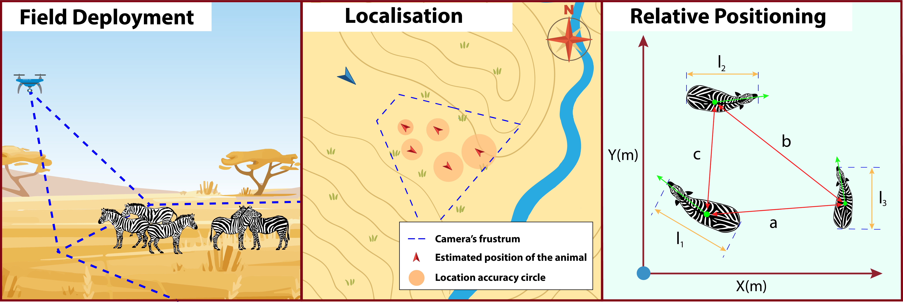

# Simulated and Field-Based Error Characterisation of Animal Geolocalisation and Relative Positioning via Commercial Drones

Supporting software and data for the paper, **Simulated and Field-Based Error Characterisation of Animal Geolocalisation and Relative Positioning via Commercial Drones**. The repository contains the symbolic derivations, camera calibration, synchronisation pipelines, simulations, field-data processing, localisation, relative-size estimation, and figure-generation code used in the study.



## Repository structure

### `data/`

- `cameraCalibration/`
	Calibration images, saved camera calibration parameters.
- `kenya/`
	Kenya field data for localisation (`loc/`) and relative-size estimation (`size/`). Each experiment contains raw inputs, preprocessed data, and result tables.
- `uk/`
	UK field data from runs performed as the Fenswood flying site. Each experiment contains raw inputs, preprocessed data, and result tables.
- `maps/`
	Orthophotos and digital elevation models used by the localisation code.

### `src/`

- `00_main_symbolicCalculations.py`
	Derives and exports the symbolic error equations used in the paper.
- `10_main_cameraCalibration.py`
	Calibrates a camera from chessboard images or video and saves its parameters as a pickle file.
- `11_main_genFigCalibration.py`
	Creates the camera-calibration figure from detected chessboard images.
- `12_main_opticalFlowSynch.py`
	Analyses optical flow and video metadata to support synchronisation between DJI recordings.
- `20_main_SIM_errorContribution.py`
	Simulates localisation and relative-size error contributions and generates Figures 5--7.
- `30_main_KENYA_preprocessing.py`
	Prepares and labels the Kenya image datasets, then computes localised object observations.
- `31_main_KENYA_localisation.py`
	Regresses Kenya localisation and size results and writes the corresponding CSV tables.
- `32_main_KENYA_plotErrorContribution.py`
	Generates the Kenya result figures (Figures 10--11).
- `33_main_KENYA_sampleDataPreview.py`
	Generates sample views of matched Kenya images and labels.
- `40_main_UK_preprocessing.py`
	Prepares the four UK image runs and performs the labelling workflow.
- `41_main_UK_localisation.py`
	Localises UK observations and aggregates localisation results.
- `42_main_UK_plotErrorContribution.py`
	Generates the UK localisation and size figures (Figures 13--14).

The remaining files in `src/` are reusable camera, image, terrain, data-structure, localisation, regression, and plotting modules.

### `figures/` and `equations/`

`figures/` contains the figures generated for the paper and selected data-collection previews. `equations/symbolic_equations.tex` contains the exported symbolic equations.

## Installation

The software was developed in VS Code. Create and activate a Python environment from the repository root, then install the dependencies:

```bash
python -m venv .venv
source .venv/bin/activate
python -m pip install --upgrade pip
python -m pip install sympy numpy matplotlib tqdm opencv-python pandas scipy pymap3d pyproj rasterio pyvista pyexiftool Pillow rioxarray
```

`pyexiftool` invokes the ExifTool executable, so ExifTool must also be installed on the system. On Debian or Ubuntu:

```bash
sudo apt install exiftool
```

Some calibration-video workflows also use `ffmpeg` to extract video frames. Package versions have not been formally pinned; dependency conflicts may occur.

## Running the analysis

Run commands from the repository root so that the relative data and figure paths resolve correctly. For example:

```bash
python src/20_main_SIM_errorContribution.py
python src/31_main_KENYA_localisation.py
python src/32_main_KENYA_plotErrorContribution.py
python src/41_main_UK_localisation.py
python src/42_main_UK_plotErrorContribution.py
```

The scripts are numbered approximately in analysis order:

1. Derive the symbolic equations and calibrate the cameras.
2. Synchronise recordings and prepare image/object labels.
3. Localise objects using the appropriate terrain map.
4. Compute regression and aggregated result tables.
5. Generate the paper figures.

The preprocessing scripts intentionally expose intermediate stages rather than hiding them in a single command. In particular, synchronisation, image labelling, and localised-image generation are stored as successive `DataProcessor` outputs. Review the relevant script before running it: several labelling and display steps are interactive, and some are commented out after the intermediate data has already been generated.

## Reproducing the field experiments

### Kenya

The Kenya workflow uses both the localisation dataset (`data/kenya/loc`) and the relative-size dataset (`data/kenya/size`). The processing stages are:

1. Run `30_main_KENYA_preprocessing.py` after completing the required synchronisation and labelling stages.
2. Run `31_main_KENYA_localisation.py` to compute localisation and relative-size regressions. This writes `kenya_results.csv` into each experiment's `results/` directory.
3. Run `32_main_KENYA_plotErrorContribution.py` to generate the Kenya result figures.

The Kenya localisation uses the Ol Pejeta terrain model and the orthophoto under `data/maps/orthophoto/opcWatertank/`.

### UK

The UK workflow processes the four Fenswood runs listed in `40_main_UK_preprocessing.py` and `41_main_UK_localisation.py`:

- `Fenswood_SquareAllRun1_RGB`
- `Fenswood_SquareAllRun2_RGB`
- `Fenswood_SquareAllRun3_RGB`
- `Fenswood_SquareAllRun4_RGB`

Run the preprocessing and labelling stages first, then localise the images and aggregate the results. Finally, run `42_main_UK_plotErrorContribution.py` to generate the UK figures from `data/uk/resultsAggredated/`.

## Camera calibration

`10_main_cameraCalibration.py` detects a 9 x 14 chessboard with 16.5 mm squares. The configured calibration inputs are in `data/cameraCalibration/calibrationPictures/`. Adjust the `CALLIB_VIDEO` mapping in the script when calibrating another camera. Calibration results are saved to `data/cameraCalibration/<camera>.pkl` and detected calibration frames are written to `figures/fig04-cameraCallib/calibPics/`.

## Reproducibility and limitations

This is research software developed over multiple iterations. It is intended to reproduce the analyses and figures associated with the paper, not to provide a production-ready flight or mapping system. Input data, camera calibration, terrain maps, image labels, and intermediate processed files must be present and consistent with the configured paths. Runtime performance, memory use, and data validation have not been comprehensively optimised or tested.

The repository includes generated figures and selected result data, but not every intermediate artefact required to rebuild every stage from raw recordings. Manual image labelling may therefore be required when starting from raw data.

## Citation

Please cite the associated paper when using this software or the included data. The manuscript is currently under review at the *Journal of Field Robotics*. A BibTeX entry is available in [CITATION.bib](CITATION.bib):

```bibtex
@article{meier_simulated_2026,
	author  = {Meier, Kilian and Rolland, Edouard G. A. and Iannino, Elena and Simpson, Mark and Kline, Jenna and Wong, Jasmin C. M. and Maalouf, Guy and Njoroge, William and Mutisya, Samuel and Watson, Matthew and Christensen, Anders L. and Costelloe, Blair R. and Richards, Arthur and Richardson, Tom and Schultz, Ulrik},
	title   = {Simulated and Field-Based Error Characterisation of Animal Geolocalisation and Relative Positioning via Commercial Drones},
	journal = {Journal of Field Robotics},
	year    = {2026},
	note    = {Manuscript under review}
}
```